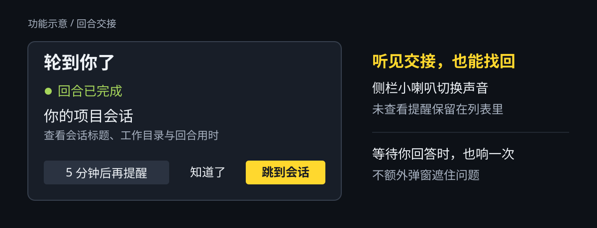

# 轮到你了 🔊

<p align="center">
  
</p>

<p align="center">
  <strong>DeepSeek Harness 的回合交接提醒插件。</strong><br>
  回合结束时弹窗并播放提示音；等待你回答问题时，也会响一次。
</p>

<p align="center">
  <a href="#安装">安装使用</a> · <a href="#设置">设置说明</a> · <a href="https://github.com/WenOwen/dsh-your-turn/issues">反馈问题</a> · <a href="./README.en.md">English</a>
</p>

<p align="center">
  <a href="#兼容性与使用边界"></a>
  <a href="#能做什么"></a>
  <a href="#设置"></a>
</p>

<p align="center">
  <a href="./README.md"></a>
  <a href="./LICENSE"></a>
</p>

## 能做什么

你可以去处理别的事。Agent 把回合交还给你时，`@wu5/dsh-your-turn` 会用弹窗和声音提醒你回来。

<p align="center">
  
</p>

- **回合结束提醒**：完成、出错、中断、截断都能提醒。居中弹窗展示会话标题、工作目录、结果与用时，也可切换为顶部横幅。
- **直接回到会话**：点击「跳到会话」继续处理，也可以点「知道了」或「5 分钟后再提醒」。
- **提问时响铃**：DSH 出现新问题、等待你回答时播放一次提示音，不额外弹窗遮住问题。
- **侧栏小喇叭**：一键开关声音；未查看提醒带计数，悬停弹出列表，指针可以直接移进列表，点图钉还能把列表固定住——查看提醒不需要点喇叭，不会误关声音。按 Esc 或点击别处收起列表，点击列表里的会话直接跳转。弹窗自动消失后，提醒仍保留在列表里。
- **六种合成音色**：成功与异常可分别选择音色，声音由浏览器实时生成，不携带音频文件。
- **同源多标签协同**：回合交接提醒在多个标签页间协调，避免重复提醒；在一处关闭，其他标签页同步关闭。

## 安装

在已配置 DeepSeek Harness 的环境中运行，将 `web` 换成你实际使用的 profile 名称（例如 `desktop`）：

```bash
npx @deepseek-ai/dsh plugin --profile web add github:WenOwen/dsh-your-turn
```

插件自带 `cordis.patch.yml` 和预构建的 `lib/`，无需自行编译。

1. 安装后重启 Harness，刷新 Web 客户端。
2. 打开 **设置 → 轮到你了**，选择提醒形式、音色与音量。
3. 点击 **试听**，解锁当前页面的声音播放权限。
4. 运行一个 Agent 回合，结束后即可看到交接提醒。

> **声音没响？** 浏览器可能尚未允许页面播放音频。先点击设置里的「试听」，并确认「播放提示音」已开启、音量不为 0。

## 设置

修改选项和开关后自动应用；输入有效值后自动保存。

| 设置 | 默认值 | 说明 |
| --- | --- | --- |
| 提醒形式 | 居中弹窗 | `modal` 为弹窗，`toast` 为顶部横幅。 |
| 自动消失 | 5 秒 | 可选择预设时长或自定义 0–600 秒；0 表示手动关闭。 |
| 播放提示音 | 开启 | 控制回合交接与提问时的声音，与侧栏喇叭同步。 |
| 成功响应 | 风铃 | 正常回合交接使用的音色。 |
| 异常响应 | 警示 | 出错、中断或截断时使用的音色。 |
| 音量 | 70 | 可调整为 0–100。 |

六种音色：**风铃** `chime`、**轻点** `ping`、**马林巴** `marimba`、**街机** `arcade`、**水滴** `drop`、**警示** `alert`。

**设置保存位置**：本机页面保存到 DSH 部署；远程页面仅保存到当前浏览器，不影响另一台电脑。页面会显示当前保存位置；只读或无法提供插件设置的部署可能无法编辑。

## 工作原理

<p align="center">
  
</p>

插件观察 Web 客户端已有的会话状态，过滤子代理会话，再将回合交接加入提醒队列。新问题通过待回答状态单独触发声音提醒。

不需要额外后台服务，不轮询会话日志文件，也不修改 DSH 核心。提示音使用 Web Audio API 实时合成。

## 兼容性与使用边界

- 当前项目对接 **DeepSeek Harness `0.2.0-rc.2`（commit `04f392c9`）**，Cordis / Client 相关包版本为 `0.1.7-rc.2`。
- 需要带 Web 客户端的 profile，例如 `web` 或 `desktop`，以及支持 Web Audio API 的浏览器。
- 客户端需要保持打开并连接 Host；关闭页面后无法继续观察回合状态。
- 弹窗与横幅显示在 DSH 页面内；声音受浏览器播放权限与系统音量影响。

## 许可

[MIT](./LICENSE)。
