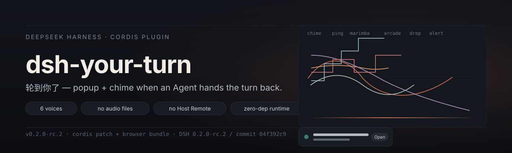

# dsh-your-turn（轮到你了）

<p align="center">
  
</p>

<p align="center">
  <strong>DeepSeek Harness 的回合交接提醒。</strong><br>
  Agent 把回合交还给你的那一瞬：一个真正能操作的居中窗口，加一段合成提示音。
</p>

<p align="center">
  <a href="./README.md">English</a> · <a href="https://github.com/WenOwen/dsh-your-turn/issues">提交问题</a> · <a href="https://github.com/WenOwen/dsh-your-turn">源码</a>
</p>

---

## 它做什么

DeepSeek Harness 的会话很少被人一直盯着——用户在另一个标签页、另一个程序、或者只是停下来想东西。Agent 停下来把回合交还给你的那一刻，这个插件就给出明确的提醒：

- **居中模态框**：带焦点管理、Escape、点击遮罩关闭。同一张卡片上展示回合结果、会话标题、工作目录、回合用时。三个动作：**跳到会话**、**5 分钟后再提醒**、**知道了**。
- **顶部横幅** 备选——觉得模态框太重时换。
- **合成提示音**：六种音色，全部由 Web Audio 在浏览器里实时合成。**插件不携带任何音频文件**，体积小、音色可调。
- **侧栏页脚的小喇叭**：和设置页共用同一个 `soundEnabled` 字段，带未读小圆点。鼠标悬停能看到所有还没看的会话，点其中一条会跳过去。

## 它有什么不一样

大多数「提醒」类 AI 插件，要么自己起一个后台服务，要么要在 Host 端加轮询，要么去监听日志文件。`dsh-your-turn` 都不需要——Web 客户端本来就知道每个会话的 Agent 是不是还在跑（它要画那个小圆点），这个插件就读这一份状态：

- **零音频资源**。插件不打包 `.mp3`、`.wav`。每种音色都是 `OscillatorNode + GainNode` 配指数包络，输出端再接一个 `DynamicsCompressor`——主增益能跑到 1.5 倍以上而不破音。
- **零 Host Remote**。不需要 API Gateway 贡献、不需要额外 schema、不需要新增页面。浏览器侧只装一个 Cordis 插件，挂一个 Slot 和一个设置面板。
- **不监听文件**。不轮询会话日志。回合结束的瞬间，Host 推给 Web 客户端，插件立刻就看见了。
- **多标签协同**。同源开三个标签页只会响一次；在一处关掉，其它处一起关。

## 它怎么工作

<p align="center">
  
</p>

插件分两半，共用同一份 Cordis 上下文。**Host 端** 声明一个轻量设置 schema（`surface`、`autoDismissSeconds`、`volume`、`soundEnabled`、`soundPreset`、`errorSoundPreset`），并告诉设置服务不要自动生成默认页。**浏览器端** 装好样式表、注册 Slot 挂件、观察 Web 客户端已经在发布的会话列表，每次回合结束：

1. 过滤子代理会话和最近刚关过的；
2. 入队一个 `Reminder`，携带会话 id、标题、工作目录和回合结果；
3. 通过声音图按配置的成功 / 失败音色播放；
4. 按 `surface` 选择渲染模态框或横幅；
5. 自动消失后条目仍留在队列里，喇叭小圆点继续可用；点 **跳到会话**、**知道了**，或在工作区里切到该会话，那条记录才被清掉。

## 安装

```bash
npx @deepseek-ai/dsh plugin --profile <你的 profile 名> add github:WenOwen/dsh-your-turn
```

插件自带 `cordis.patch.yml` 和预构建的 `lib/`，用户机器上**不需要任何构建步骤**。重启 Harness，刷新浏览器，**设置 → 回合交接提醒** 那一节就能用。

## 设置

| 设置页显示名 | 字段 | 默认 | 含义 |
| --- | --- | --- | --- |
| 提醒形式 | `surface` | `modal` | 居中模态 `modal` 或顶部横幅 `toast`；旧配置里的 `both` 会解析成 `modal`。 |
| 自动消失 | `autoDismissSeconds` | `5` | 提醒出现这么久后自动关闭；`0` 表示不自动消失，需要手动关闭。下拉里有「从不 / 5 秒 / 10 秒 / 30 秒 / 1 分钟 / 2 分钟 / 5 分钟」，也可选「自定义…」输入 0–600 任意整数。 |
| 播放提示音 | `soundEnabled` | `true` | 是否播放提示音；侧栏页脚那个小喇叭切换的是同一个字段。 |
| 成功响应 | `soundPreset` | `chime` | 正常交接时使用的音色。 |
| 异常响应 | `errorSoundPreset` | `alert` | 出错、被中断或被截断时使用的音色。 |
| 音量 | `volume` | `70` | 0–100，会乘上 1.5 倍主增益并经限制器削顶。 |

六种音色：`chime`（双分音风铃）、`ping`（轻点）、`marimba`（马林巴）、`arcade`（上行街机琶音）、`drop`（水滴）、`alert`（三音警示）。静音不是第七种音色，是那个开关。

## 兼容性

- **DeepSeek Harness `0.2.0-rc.2` / commit `04f392c9`**，Cordis 与 Client 运行时 `0.1.7-rc.2`。
- 需要带 Web 客户端的 profile（`web` 或桌面应用的 `desktop`）。
- 需要支持 Web Audio 的浏览器（近十年出的都行）。
- 客户端必须保持与 Host 的连接才能观察回合结束；关掉页面就关掉提醒。

## 致谢

- 所有读取的状态都由 Web 客户端提供。**没有扩展任何 Host API，没有修改 DSH 核心**。
- 插件结构遵循 [build-deepseek-harness-plugin](../.agents/skills/build-deepseek-harness-plugin/SKILL.md) 约定：一条 Cordis Loader 行，一个 Client Slot 挂件，一个设置面板，复用主题 Token。

## 许可

MIT。
